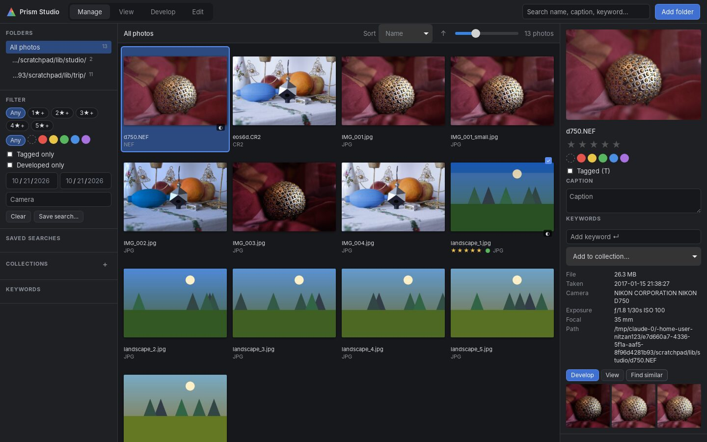
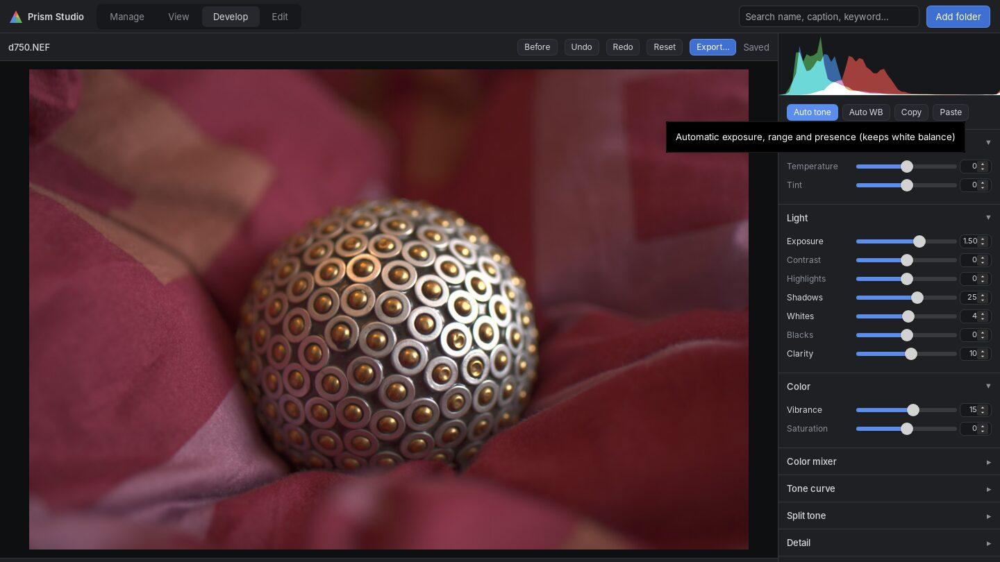
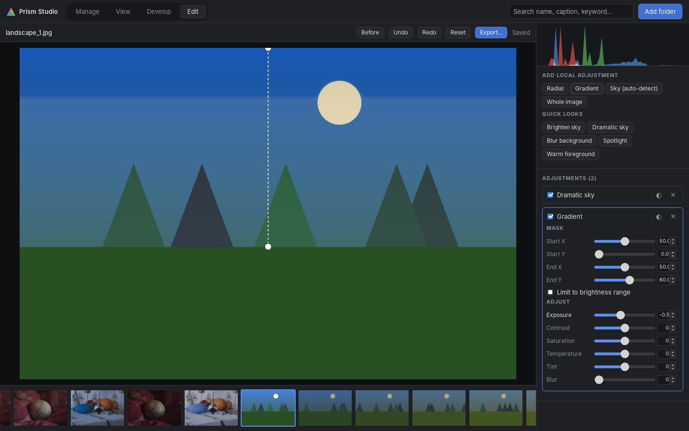
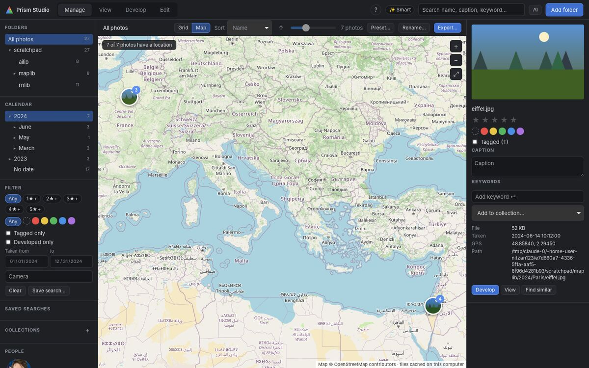

# Prism Studio

A fast desktop photo manager and RAW editor that never changes your original
files. You can browse, rate, tag and search a large library, develop RAW
files with live sliders, and make masked local edits. Everything is stored in
a catalog and in standard XMP sidecars.

Built with **Rust + Tauri 2**. Runs on Windows, macOS and Linux.

The feature set takes inspiration from ACDSee Photo Studio. Every line of
code is original — see [docs/reverse-engineering-findings.md](docs/reverse-engineering-findings.md)
for what was studied and where the clean-room boundary sits.

| Manage | Develop | Edit (local masks) |
|---|---|---|
|  |  |  |

## Features

**Manage**
- **Open from anywhere**: double-click a photo or use "Open with" in your
  file manager (JPEG, HEIC, PNG, TIFF, WebP, AVIF, JPEG XL and common RAW
  formats). Its folder
  joins the library and the photo opens; a running Prism Studio picks it up
  instead of starting a second copy.
- **Folders stay in sync**: while the app runs it watches your library
  folders, so photos copied in, edited elsewhere, renamed or deleted show up
  by themselves (changes are batched; a camera import is one update).
- **Folder tree**: nested folders with photo counts; selecting a folder
  shows it with everything below it.
- **Remove a folder from the library** (✕ next to it in the tree, after a
  confirmation): its photos stop showing in Prism Studio. Nothing is deleted
  from disk, and stars, keywords and edits stay in the XMP sidecars, so
  adding the folder again brings them back. A removed sub-folder stays out
  even though its parent is still watched.
- **Calendar**: browse by year › month › day of capture (plus "No date").
- **Map**: photos with GPS on an OpenStreetMap map, clustered, honouring the
  current folder and filters. Click a cluster to select its photos, open one,
  or zoom in. Map tiles are downloaded from openstreetmap.org by the app
  (identifying itself, as OSM's tile policy asks) and cached on disk for 30
  days, so areas you've seen work offline. Only tile coordinates are sent,
  never photos or their exact positions.

  
- Add folders (recursive). A background indexer reads EXIF and builds
  thumbnails (RAW files use their embedded preview), then computes
  perceptual hashes.
- Virtualised grid that stays fast with large libraries. Supports multi-select
  (click, Ctrl/⌘, Shift) and Ctrl+A.
- Ratings (`0`–`5`), colour labels (`6`–`9`), tagged (`T`), captions,
  keywords and collections.
- Filters: rating, label, tagged, developed, date range, camera and free text
  (matches file name, caption and keywords). Searches can be saved.
- **Find similar**: near-duplicate detection with a 64-bit dHash.
- Sorting by name, capture date, rating, size or modified date.

Press `?` anywhere for the keyboard shortcut list.

**View**: full-screen viewer with filmstrip, wheel or arrow-key navigation,
and 1:1 zoom with panning (`Z` or click).

**Develop** (non-destructive, live preview, histogram):
- White balance, exposure, contrast, highlights, shadows, whites, blacks,
  clarity, vibrance and saturation.
- **8-band colour mixer** (hue, saturation and luminance), tone curve
  (monotone cubic), split toning, sharpening, noise reduction and vignette.
- Geometry: rotate, flip, straighten (auto-scales so no blank corners
  appear) and crop with aspect presets.
- **Auto tone**, a separate conservative **Auto WB**, before/after (`\`),
  undo/redo (Ctrl+Z / Ctrl+Shift+Z), and copy/paste of settings to a
  selection. Edits autosave.
- Real RAW decoding from sensor data (rawloader) at **full sensor
  resolution**: Malvar–He–Cutler demosaic for Bayer sensors and a 5×5
  interpolation for Fuji X-Trans. Previews use a fast half-resolution path;
  export and 1:1 zoom use the full-resolution decode (6000×4000 in about 2 s).
  Tested on Nikon NEF and Canon CR2.
- **Lens correction** fixes distortion, vignetting and chromatic aberration:
  - Profiles: the lensfun database (1,500+ lenses, downloaded in-app on
    request). The photo's lens is matched from EXIF and its profile is
    interpolated for the focal length and aperture.
  - Each correction has a strength slider, plus manual sliders for lenses
    without a profile.
  - The image auto-zooms so no blank borders appear.

**Edit**: local adjustments, each with its own exposure, contrast,
saturation, temperature, tint and blur.
- Masks: **brush** (paint and erase, with size, feather and flow), radial,
  linear gradient, **sky (auto-detect)**, AI subject/sky and whole image.
  Any mask can be inverted or limited to a brightness range.
- Drag the handles on the photo to place a mask, or paint it.
- **Heal and clone** spot retouching: click a blemish and the best
  matching source is picked for you (or drag to choose it). Heal blends the
  copied texture into the surrounding light and colour; clone copies
  exactly. Spots are anchored to the original photo, so they stay in place
  if you crop or rotate afterwards.
- Quick looks: Brighten sky, Dramatic sky, Blur background, Spotlight,
  Warm foreground.

**AI** (optional, runs on this computer; photos are never uploaded):
- One-time download of four open models (about 131 MB, SHA-256 verified):
  YuNet + SFace for faces (MIT / Apache-2.0), TinyCLIP for image–text
  understanding (MIT) and U²-Netp for subject segmentation (Apache-2.0).
  Inference is pure Rust (tract), so there is no native ML runtime to install.
- **People**: faces are detected, embedded and grouped into people. Name a
  person once and every photo of them is searchable; click a person in the
  People panel to filter.
- **Smart search** (✨): describe a photo in words ("dog on the beach",
  "group photo in uniform") and get ranked matches.
- **Suggested keywords** in Properties, from a 140-label photo vocabulary;
  one click adds them as real keywords.
- **Find similar** uses CLIP embeddings once photos are analysed (dHash
  otherwise).
- **AI masks** in Edit: Subject, Sky and Blur background. The mask is stored
  with the edit and follows rotation, crop and lens correction.

**Workflow** (batch):
- **Presets**: 8 built-in looks (Vivid, Black & white, Matte, Warm film, …)
  plus your own (“Save current…” in Develop). A preset changes the look
  only: each photo keeps its crop, lens correction and local adjustments,
  so one preset can be applied to a whole shoot from Manage (Preset…).
- **Batch rename** (Manage → Rename…) with a template such as
  `{date}_{name}` or `Trip_{seq:3}`. Tokens: `{name}`, `{seq}`/`{seq:N}`,
  `{date}`, `{time}`, `{year}`, `{month}`, `{day}`, `{camera}`, `{rating}`.
  Dates come from EXIF, or the file's modified date if there is none. A
  live preview shows every new name and flags clashes before anything moves;
  sidecars move with their photos, and swaps inside one batch are safe.

**Export**: JPEG, PNG, TIFF or WebP (lossless), full-size or resized, with
your develop settings applied and an optional file-name template (same
tokens as rename). Available from Manage (batch) and Develop.
- **Metadata is embedded** in every format: EXIF (camera, lens, exposure,
  capture date, GPS, copyright) and XMP (rating, keywords, caption,
  copyright), readable by Lightroom, Photos, Google Photos, Flickr and
  others. Options: leave metadata out, drop just the location (for public
  sharing), and add a copyright line.
- Text on photos is part of each photo's edit (see **Text on photos** below),
  so exports show it exactly as in the app.

**Text on photos** ("Vicuña, Chinchero, 01.10.2026"):
- Select photos → **📝 Date & place…** → one click adds a line of text to all
  of them: what/where (typed by you), the place from the photo's GPS
  (OpenStreetMap: the nearest named place and the town, e.g. "Museo Larco,
  Lima"; "Distrito de Cusco" → "Cusco") and the date in the
  format you choose (default `23.09.2026`). Italic, bottom left or centre,
  colour picked automatically (or black/white); wraps at commas on narrow
  photos.
- The exact place (museum, park, temple…) is the nearest named object on the
  map to the photo's GPS. It is accepted as is, so everything can be
  exported straight away; GPS drift occasionally picks the building next
  door, so a quick look before exporting is worthwhile (fix it in the Place
  box). Places estimated for photos without GPS use the town only and stay
  marked "? check". "Town only" and "Town, country" are still available.
- Ctrl + / Ctrl − / Ctrl 0 make the whole interface bigger, smaller or
  normal (remembered); on small laptop screens it starts slightly smaller.
- The photo's own data comes first: camera date and GPS. Without them, the
  date is taken from the file name (WhatsApp `2026-10-20 at 21.32.51`, phone
  `IMG_20261020_…`), optionally from the file date.
- **Photos without GPS** (most cameras) get a place worked out from other
  evidence, and are marked **? check** with an explanation:
  - a photo with GPS from the same camera a few minutes apart;
  - a **phone photo** taken at about the same time — the camera's clock
    offset (e.g. still on home time, +8 h) is detected automatically from
    all its photos;
  - an imported **Google Maps location history** (Timeline export; on-device
    `Timeline.json`, phone `location-history.json` or Takeout `Records.json`).
  Dates read from file names (WhatsApp: when it was *sent*) are marked too.
- **📍 Review places** groups the photos needing attention by time: type the
  place once per group or press ✓ if the estimate is right. Photos with no
  place at all are red. Typed or confirmed text is never overwritten.
  "Rename … everywhere" fixes a place on all photos (e.g. Lince → Lima).
- Fine-tune a single photo in Develop → Text on photo.

## File formats

| | |
|---|---|
| Raster | JPEG, PNG, TIFF, WebP, GIF, BMP. Files are recognised by content, so a PNG saved as `.jpg` still opens. |
| Phone / modern | HEIC and HEIF (iPhone, Samsung, Canon/Sony `.hif`), AVIF, JPEG XL. Rotation, date, camera and GPS are read from HEIC like from JPEG. Decoded at 8 bits per channel; HDR gain maps are ignored. |
| RAW | CR2, NEF, ARW, DNG, ORF, RW2, RAF, PEF, SRW and [many more](crates/prism-core/src/raw.rs) via rawloader. CR3 has a thumbnail preview only. |
| Sidecar | `photo.ext.xmp`, which holds `xmp:Rating`, `xmp:Label`, `dc:subject` and `dc:description`. Lightroom, darktable and digiKam can read these. Develop settings are stored in the `prism:` namespace. If `photo.ext.xmp` was written by another program (for example darktable's edit history), Prism never overwrites it: it reads the rating and keywords from it and writes its own data to `photo.ext.prism.xmp` instead. |

## Get it (Windows)

Every push builds a fresh Windows installer at a fixed link:
<https://github.com/nitzan123/nitzan123/releases/download/windows-latest/PrismStudio-setup.exe>

Run it (no admin rights needed). It's unsigned, so the first time Windows
shows "Windows protected your PC": click **More info → Run anyway**. To
update, download and run it again; your library and edits are kept.

## Build and run

Requirements: Rust (stable) and the
[Tauri 2 system prerequisites](https://v2.tauri.app/start/prerequisites/)
(on Linux: `libwebkit2gtk-4.1-dev libgtk-3-dev libsoup-3.0-dev librsvg2-dev`).

```bash
cargo run -p prism-studio --release                # start the app
cargo run -p prism-studio --release -- ~/Pictures  # start and index a folder (or open a photo)
cargo test --workspace                             # 93 tests (unit + robustness)
```

**Installers**: pushing a tag like `v0.2.0` makes GitHub Actions build
Windows (`.msi`, `.exe`), macOS (universal `.dmg`) and Linux (`.deb`,
`.rpm`, `.AppImage`) installers into a draft release, signed and notarized
when signing certificates are configured. See
[docs/releasing.md](docs/releasing.md). To build one locally:

```bash
cd src-tauri && npx @tauri-apps/cli@2 build   # output: target/release/bundle/
```

There is also a headless develop tool, useful for checking decoder and
pipeline output:

```bash
cargo run --release --example develop_cli -- out/ photo1.NEF photo2.CR2
```

## Quality

- **93 automated tests**, including an end-to-end robustness suite. It uses a
  generated library of awkward files: Hebrew folder and file names, spaces,
  EXIF-rotated portraits, 16-bit TIFF, alpha PNG, 1×1 images, empty, truncated
  and fake files. It checks that everything indexes, thumbnails, decodes and
  renders, and that broken files fail on their own without stopping the batch.
- CI on every push (`.github/workflows/ci.yml`): rustfmt, clippy with
  `-D warnings`, the tests, and a UI syntax check.
- Performance on 4 CPU cores with 1,000 photos at 6 MP:

  | Step | Time |
  |---|---|
  | Metadata scan | 29 ms |
  | Thumbnails | 11 s |
  | Search | 2 ms |
  | Rescan when nothing changed | 37 ms |
  | Rating 1,000 selected photos | instant (no per-photo round trip) |

## Architecture

```
crates/prism-core   UI-agnostic engine (all logic, all tests)
  catalog.rs        SQLite catalog: assets (incl. GPS), folders, keywords, collections, presets, saved searches, develop JSON, library roots and removed folders; migrations
  scan.rs           folder walk + EXIF incl. GPS (parallel, tolerant of malformed EXIF)
  geocode.rs        GPS → "City, Country" via OpenStreetMap (rate-limited, cached)
  tiles.rs          OpenStreetMap map tiles with an on-disk cache and offline fallback
  overlay.rs        caption text rendering (bundled DejaVu Sans Bold, bidi-aware)
  imaging.rs        single entry point for decoding (display path / linear path): raster, HEIC/AVIF, JPEG XL, RAW
  raw.rs            embedded-preview extraction, RAW decode → linear sRGB, base curve
  demosaic.rs       full-resolution demosaic (Malvar–He–Cutler Bayer, generic CFA)
  lens.rs           lensfun DB parse/match/interpolate + distortion/TCA/vignetting correction
  thumbs.rs         content-keyed on-disk thumbnail cache (+ developed variants)
  similarity.rs     dHash + Hamming distance
  xmp.rs            sidecar read/write
  embed.rs          EXIF/XMP writer for exported files (JPEG, PNG, WebP, TIFF)
  watch.rs          turns file-system change bursts into minimal index/prune jobs
  develop/          settings model, render pipeline, masks (incl. brush), heal/clone, auto
  workflow.rs       presets, file-name templates, safe batch rename, export encoders
  ai/               model download, faces (YuNet/SFace), CLIP + tokenizer, U²-Netp, keyword vocabulary
src-tauri           Tauri shell: commands, background indexer, folder watcher, AI job, prism:// image protocol
ui                  vanilla ES modules, no build step
```

Render pipeline order (see `develop/pipeline.rs`):
heal/clone spots → lens correction → geometry → WB / exposure (linear) → tone (highlights, shadows, whites,
blacks, contrast with roll-off) → clarity → display sRGB → tone curve →
colour mixer, vibrance, saturation → split tone → local masks → vignette →
noise reduction and sharpening.

## Known limitations (v0.1)

- RAWs the decoder can't read (e.g. CR3) are developed from their embedded
  JPEG. X-Trans demosaicing is simpler than Bayer's (fine detail is softer).
- Lens matching needs the lens name in EXIF; some bodies (e.g. many Nikons)
  don't record it, so use the manual sliders there.
- AI models are small so they run on any CPU. The subject mask works at
  320 px and is soft at fine edges (hair); in group photos, people far behind
  the main subject may be partly treated as background. Keyword suggestions
  are limited to the built-in vocabulary. Analysis takes about 0.3 s per
  photo plus about 3 s per AI mask.
- Masks (radial, gradient, brush) are placed on the developed frame, so
  changing the crop afterwards moves them with the frame; heal/clone spots
  don't move. Healing works best with small spots: a spot whose edge
  crosses a strong edge (an object outline) can smear it, as with any
  healing brush; drag the source or use clone there.
- Folder watching covers folders added with "Add folder". In catalogs from
  older versions, the folders that held photos are watched; add the parent
  folder once to also catch brand-new subfolders.
- WebP export is lossless only (the pure-Rust encoder has no lossy mode);
  exports are 8-bit. Renames can't be undone from the app, which is why the
  dialog previews every name first. CR3 full decode is not supported.
- HEIC/AVIF decoding uses the pure-Rust [`heic`](https://crates.io/crates/heic)
  crate, licensed AGPL-3.0 (or commercially). That is fine for this app's
  own use, but anyone redistributing builds publicly must either publish
  the source under AGPL terms or buy the commercial licence. HEVC itself is
  patent-encumbered in some countries; decoding for personal use is the
  common case. Very large images (around 200 MP) exceed the decoder's 1 GB
  memory cap and are refused.

See [docs/architecture.md](docs/architecture.md) for the roadmap.

## Credits

The RAW sample files used in screenshots and testing come from
[raw.pixls.us](https://raw.pixls.us) (CC0). Caption font: DejaVu Sans Bold
(see `crates/prism-core/assets/fonts/DejaVu-LICENSE.txt`). Place names:
© OpenStreetMap contributors, ODbL.
Lens profiles: [lensfun](https://lensfun.github.io) (CC BY-SA 3.0),
downloaded on request. AI models (downloaded on request, not bundled):
YuNet and SFace from OpenCV Zoo (MIT, Apache-2.0), TinyCLIP (MIT, Microsoft),
U²-Netp (Apache-2.0).
